# Course Vision – Iteration 1 Report

CMPT 276 Group 16 \
**Live app:** [https://cmpt276-group16-course-vision.onrender.com](https://cmpt276-group16-course-vision.onrender.com)\
Test accounts for every role are listed in [2.3 Test Account Credentials](#23-test-account-credentials).
## 1. Project Overview

### 1.1 Project Description

Course Vision is a web application that helps SFU Computing Science and Computer Engineering students who entered in 2023 or 2024 plan their degrees. Starting from a student's unofficial transcript, it will show which courses the student can take next, let them save alternative schedules and plans, and report how much of their degree remains. Students, course advisors and IT managers each use the system with their own permissions.

### 1.2 Iteration 1 Scope

Iteration 1 focused on the foundation that every later feature depends on, which is secure accounts with role-based access and a way to get a student's academic record into the system.

From the Permission System & Database Management epic, we built the user model with three roles (Student, Advisor and IT Manager) and implemented registration, login and logout from scratch. Students create their own accounts through a registration form, and passwords are stored as BCrypt hashes. Advisor and IT manager accounts cannot be created through registration. Instead, the system creates these accounts, so no one can give themselves a staff role. After logging in, each user lands on a home page for their role, and the server prevents users from opening pages that belong to other roles. Advisors can see a list of the students assigned to them, and IT managers can see every account grouped by role, without password hashes or coursework.

Our first and most important feature is transcript upload, from the Transcript Upload & Manual Correction epic. A student uploads their SFU unofficial transcript as a PDF, reviews the courses the system found, and confirms the list to save the courses to their record. If the student does not confirm, nothing is saved. The student can then view their saved courses on a "My courses" page, grouped by term. We chose this feature first because the Course Eligibility Engine, Course Planning and Graduation Report all depend on the student's academic record.

## 2. Requirements

Course Vision has three user types, and each one signs in to its own home page. This section introduces each type through a persona, summarizes what each role can do, lists the test accounts, and then describes every Iteration 1 feature as a user story with acceptance criteria and test cases.

### 2.1 User Types and Personas

**Student.** Students are the primary users of Course Vision. Priya is a Computing Science student from the 2024 cohort who works part-time and commutes to campus. She wants to see her completed courses in one place without typing them in by hand, so she creates an account, uploads her SFU unofficial transcript and checks the courses the system found. Marcus is a Computer Engineering student from the 2023 cohort. He represents the second program and cohort that the application supports, and he uses the same student features as Priya.

**Course Advisor.** A course advisor supports a group of assigned students, including Marcus. Before an appointment, the advisor wants to know whose progress they are responsible for. In Iteration 1, the advisor signs in with an account created for them and sees a list of their assigned students. In later iterations, the advisor will also review those students' progress and plan on their behalf.

**IT Manager.** Aisha is the IT manager for Course Vision. She is responsible for keeping the system set up correctly, so she needs to see every account and its role. She must not see students' passwords or coursework, because that data is private to each student.

### 2.2 Role Permission Summary

The table below shows what each role can do in Iteration 1. The server checks the role on every protected page, so a user cannot reach another role's pages by typing the address directly.

| Action | Student | Advisor | IT Manager |
| --- | --- | --- | --- |
| Create an account through the sign-up form | Yes | No | No |
| Log in and log out | Yes | Yes | Yes |
| Upload a transcript and save the parsed courses | Yes | No | No |
| View saved courses | Own record only | No | No |
| View a list of assigned students | No | Yes | No |
| View all accounts and their roles | No | No | Yes |
| See password hashes or coursework of other users | No | No | No |
| View and edit own display name and password | Yes | Yes | Yes |
| Change own program and entry year | Yes | No | No |
| Change own email or role | No | No | No |

### 2.3 Test Account Credentials

The accounts below are created automatically when the application starts. Advisor and IT manager accounts cannot be created through the sign-up form, so markers need these accounts to test the staff views. The demo advisor is assigned to both demo students. Email addresses are not case-sensitive.

| Role | Display name | Email | Password |
| --- | --- | --- | --- |
| Advisor | Demo Advisor | advisor@example.com | password123 |
| IT Manager | Faye | Faye@example.com | password123 |
| Student (Computing Science, 2024) | Madden | madden@test.com | password123 |
| Student (Computer Engineering, 2023) | Jack | jack@test.com | password123 |

### 2.4 User Stories

Every story below uses the same template. Each story gives the user story in persona, action and result form, followed by a description, the acceptance criteria, success and failure test cases, and the related UI. Error messages in the test cases are quoted exactly as they appear in the application.

#### 2.4.1 Registration

**Story 1. Student Registration**

**User story.** As a student like Priya, I want to create an account with my email and password, so that my academic record stays private to me.

**Description.** A new student opens the sign-up page from the login page and fills in their email, display name, password, password confirmation, program and entry year. The program list only offers Computing Science and Computer Engineering, and the entry year list only offers 2023 and 2024, because these are the cohorts Course Vision supports. The server checks every field and shows all problems at once, keeping the values the student typed except the passwords. When the form is valid, the account is saved with the Student role, the student is signed in automatically and they land on the student home page. The form has no way to choose a role, so it can never create an advisor or IT manager account.

**Acceptance criteria.**

- The form asks for email, display name, password, confirm password, program and entry year.
- Email must be in a valid format and must not already be registered. The duplicate check is not case-sensitive.
- Passwords must be at least 8 characters and both password fields must match.
- Passwords are stored as BCrypt hashes, never as plain text.
- After registering, the student is signed in and lands on the student home page.
- The form cannot create an advisor or IT manager account.

**Test cases.**

| ID | Type | Steps | Expected result |
| --- | --- | --- | --- |
| TC 1.1 | Success | Fill in a new email, a display name, a matching password of 8 or more characters, Computing Science and 2024, then click Sign up. | The account is created and the student is redirected to the student home page, which shows "Welcome" and their display name. |
| TC 1.2 | Success | After TC 1.1, check the new user record in the database. | The password is stored as a BCrypt hash and the role is Student. |
| TC 1.3 | Failure | Register with an email that already exists, such as Faye@example.com or FAYE@EXAMPLE.COM. | The page shows "An account with this email already exists." and no account is created. |
| TC 1.4 | Failure | Click Sign up with every field empty. | The browser asks the student to fill in the empty fields. If this is bypassed, the page lists an error for each one, such as "Email is required." |
| TC 1.5 | Failure | Enter an email whose domain has no dot, such as student@sfu. | The page shows "Email format is not valid." |
| TC 1.6 | Failure | Enter a password with fewer than 8 characters. | The browser asks for at least 8 characters. If this is bypassed, the page shows "Password must be at least 8 characters." |
| TC 1.7 | Failure | Enter two different passwords. | The page shows "Passwords do not match." and both password fields are cleared. |
| TC 1.8 | Failure | Leave the program or entry year on "Choose". | The browser asks the student to choose an option. If this is bypassed, the page shows "Choose a program." or "Choose an entry year." |
| TC 1.9 | Failure | While signed in, open /register. | The user is redirected to their own home page instead of seeing the form. |

**UI.** The first screenshot shows the empty sign-up form. The second shows the error when the email is already registered. The typed email, display name, program and entry year are kept, and the password fields are cleared.

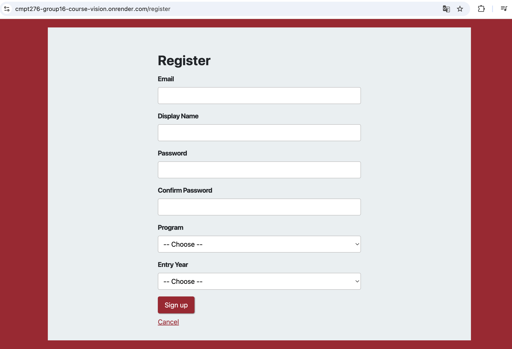

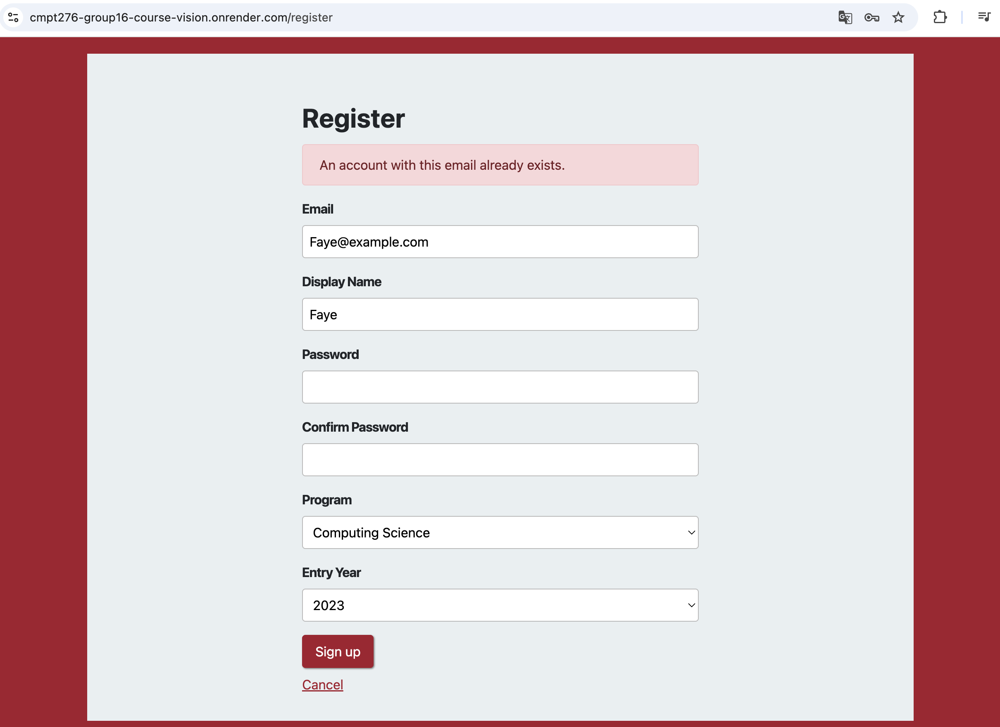

#### 2.4.2 Login

**Story 2. Log In**

**User story.** As a student, advisor or IT manager, I want to log in with my email and password, so that only I can use my account.

**Description.** The login page is the first page of the application, and visiting the root address redirects to it. A user enters their email and password and clicks Sign in. If the details are correct, the server starts a new session and sends the user to the home page for their role. If the email is unknown or the password is wrong, the page shows the same message in both cases, so an attacker cannot tell which emails are registered. The typed email is kept so the user only needs to retype the password. A user who is already signed in and opens the login page is sent straight to their home page.

**Acceptance criteria.**

- The correct email and password sign the user in and take them to their role's home page.
- A wrong email and a wrong password show the same message, "Invalid email or password."
- Email is not case-sensitive.
- A new session is started on every successful login.

**Test cases.**

| ID | Type | Steps | Expected result |
| --- | --- | --- | --- |
| TC 2.1 | Success | Log in as madden@test.com with password123. | The user is redirected to the student home page. |
| TC 2.2 | Success | Log in as advisor@example.com with password123. | The user is redirected to the advisor home page. |
| TC 2.3 | Success | Log in as Faye@example.com with password123. | The user is redirected to the IT manager home page. |
| TC 2.4 | Success | Log in as MADDEN@TEST.COM with password123. | Login succeeds, because email is not case-sensitive. |
| TC 2.5 | Failure | Log in as madden@test.com with a wrong password. | The page shows "Invalid email or password." and keeps the typed email. |
| TC 2.6 | Failure | Log in with an email that is not registered, such as test@sfu.ca. | The page shows the same message, "Invalid email or password." |
| TC 2.7 | Failure | Click Sign in with the email or password left blank. | The browser asks the user to fill in the empty field. If this is bypassed, the page shows "Invalid email or password." |
| TC 2.8 | Failure | While signed in, open /login. | The user is redirected to their own home page. |

**UI.** The first screenshot shows the login page. The second shows the error after a failed login with an unregistered email.

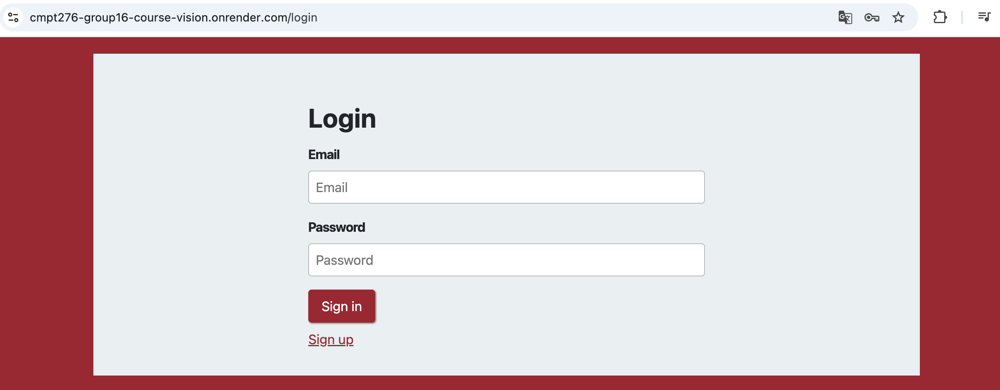

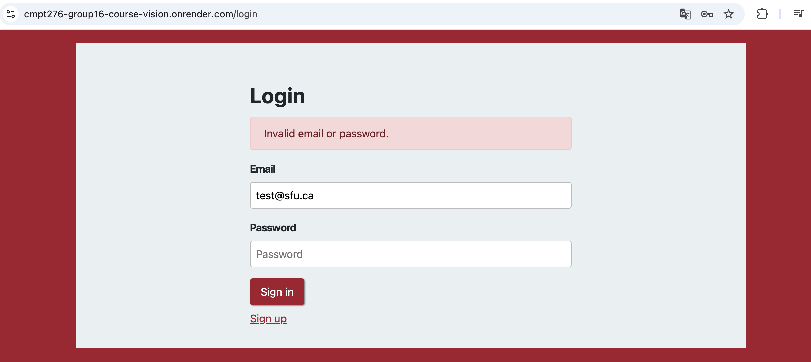

#### 2.4.3 Logout

**Story 3. Log Out**

**User story.** As a student, advisor or IT manager, I want to log out, so that nobody else using the same computer can open my account.

**Description.** Every signed-in page has a Sign out button in the header. Clicking it ends the session on the server and returns the user to the login page. Protected pages are sent with headers that stop the browser from caching them. As a result, pressing Back after logging out does not show the previous page, and the request is checked again and redirected to the login page.

**Acceptance criteria.**

- Every signed-in page shows a Sign out button.
- Logging out ends the session and returns the user to the login page.
- Pressing Back after logging out does not show the previous page.

**Test cases.**

| ID | Type | Steps | Expected result |
| --- | --- | --- | --- |
| TC 3.1 | Success | Log in as any test account, then click Sign out. | The session ends and the user is redirected to the login page. |
| TC 3.2 | Failure | After TC 3.1, press the browser's Back button. | The previous page is not shown, and the user is redirected to the login page. |
| TC 3.3 | Failure | After TC 3.1, type /student/home into the address bar. | The user is redirected to the login page. |

**UI.** The Sign out button appears in the header of every signed-in page, as shown in the student home page screenshot in Story 4.

#### 2.4.4 Role-Based Views

**Story 4. Role-Based Home Pages and Access**

**User story.** As a user of any role, I want to land on the home page for my role and be unable to open other roles' pages, so that private data stays protected.

**Description.** Each role has its own area of the application. Student pages start with /student/, advisor pages with /advisor/ and IT manager pages with /it/. Before any of these pages loads, the server checks the session. A visitor who is not signed in is sent to the login page. A signed-in user who opens a page that belongs to another role is sent to their own home page instead. Because the check runs on the server, typing another role's address into the browser cannot bypass it. Every home page greets the user by display name and shows a Sign out button.

**Acceptance criteria.**

- Students, advisors and IT managers each have their own home page showing their name and a Sign out button.
- Opening a protected page while signed out redirects to the login page.
- Opening another role's page sends the user to their own home page.
- The server enforces these checks.

**Test cases.**

| ID | Type | Steps | Expected result |
| --- | --- | --- | --- |
| TC 4.1 | Success | Log in as each of the three roles in turn. | Each user sees their own home page with "Welcome", their display name and a Sign out button. |
| TC 4.2 | Failure | While signed out, open /student/home, /advisor/home or /it/home. | The visitor is redirected to the login page. |
| TC 4.3 | Failure | Log in as madden@test.com, then open /advisor/home. | The student is redirected to /student/home. |
| TC 4.4 | Failure | Log in as advisor@example.com, then open /it/home. | The advisor is redirected to /advisor/home. |
| TC 4.5 | Failure | Log in as Faye@example.com, then open /student/home. | The IT manager is redirected to /it/home. |

**UI.** The screenshot shows the student home page for the demo student Madden. It greets the student by name, links to the transcript upload page and shows a Sign out button in the header.

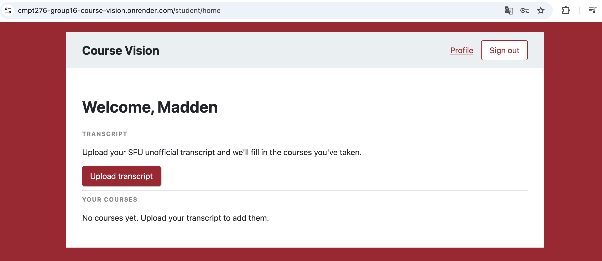

**Story 5. Advisor Views Assigned Students**

**User story.** As a course advisor, I want to see a list of the students assigned to me, so that I know whose progress I am responsible for.

**Description.** The advisor home page shows a table of the students assigned to the signed-in advisor. Each row shows the student's name, email, program and cohort, and the rows are sorted by name. An advisor only sees their own students, never every student in the system. An advisor with no assigned students sees a short message instead of an empty table. The demo advisor is assigned to both demo students, so markers can see a filled-in list.

**Acceptance criteria.**

- The advisor home page lists each assigned student's name, email, program and cohort.
- Students are sorted by name.
- Advisors only see their own students.
- An advisor with no students sees "No students are assigned to you yet."

**Test cases.**

| ID | Type | Steps | Expected result |
| --- | --- | --- | --- |
| TC 5.1 | Success | Log in as advisor@example.com. | The page lists Jack and Madden with their email, program and cohort, sorted by name. |
| TC 5.2 | Success | Log in as an advisor who has no assigned students. | The page shows "No students are assigned to you yet." |
| TC 5.3 | Failure | Register a new student, then log in as advisor@example.com. | The new student does not appear, because they are not assigned to this advisor. |
| TC 5.4 | Failure | Log in as madden@test.com, then open /advisor/home. | The student is redirected to /student/home and cannot see the list. |

**UI.** The screenshot shows the advisor home page for the demo advisor. It lists the two assigned students, Jack and Madden, with their email, program and cohort, sorted by name.

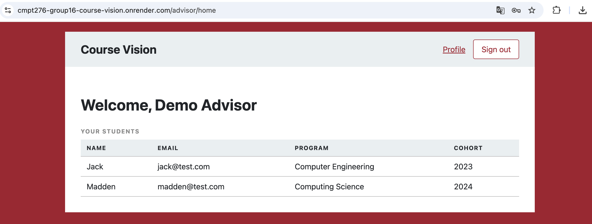

**Story 6. IT Manager Views All Accounts**

**User story.** As an IT manager like Aisha, I want to see every account and its role, so that I can check that accounts are set up correctly.

**Description.** The IT manager home page lists every user's name, email and role, grouped by role, together with the total number of accounts. This lets the IT manager confirm, for example, that a new student registered with the right role. The page never shows password hashes or coursework, because the IT manager role maintains the system and does not need students' private records.

**Acceptance criteria.**

- The IT home page lists every user's name, email and role, grouped by role.
- The page shows the total number of accounts.
- Password hashes and coursework are never shown.

**Test cases.**

| ID | Type | Steps | Expected result |
| --- | --- | --- | --- |
| TC 6.1 | Success | Log in as Faye@example.com. | The page lists every account grouped by role, with name, email, role and the total count. |
| TC 6.2 | Success | Register a new student, then log in as Faye@example.com. | The new student appears under Student and the total count increases by one. |
| TC 6.3 | Failure | On the IT home page, look for passwords or courses. | No password hashes and no coursework appear anywhere on the page. |
| TC 6.4 | Failure | Log in as advisor@example.com, then open /it/home. | The advisor is redirected to /advisor/home and cannot see the list. |

**UI.** The screenshot shows the IT manager home page for the demo IT manager Faye. It lists every account with its name, email and role, and shows the total number of accounts above the table.

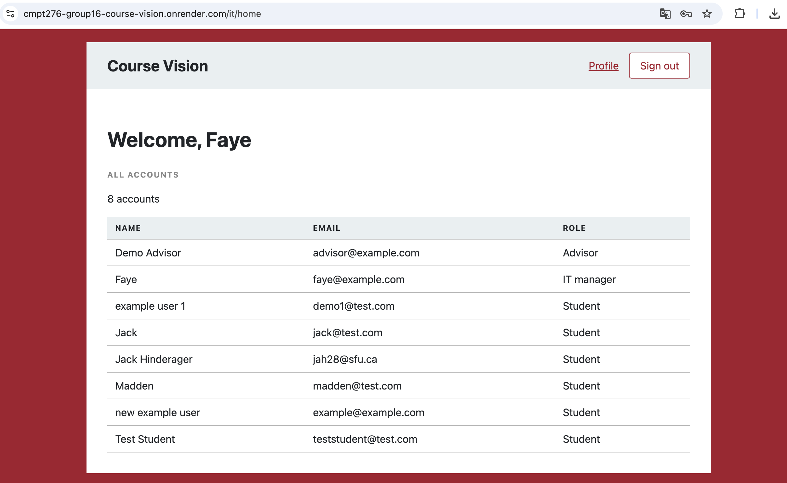

#### 2.4.5 Core Feature

The core feature of Iteration 1 is transcript upload. It turns a student's SFU unofficial transcript into a saved academic record, which the Course Eligibility Engine, Course Planning and Graduation Report will all depend on in later iterations. The feature is split into three stories that follow the student's path from uploading the PDF to viewing the saved courses.

**Story 7. Upload an Unofficial Transcript**

**User story.** As a student like Priya, I want to upload my SFU unofficial transcript and review the courses it found, so that I do not have to type my courses by hand.

**Description.** The student home page links to an upload page, which asks the student to download their unofficial transcript PDF from goSFU and upload it. The file picker only accepts PDF files, and files larger than 1 MB are rejected. After upload, the server reads the text of the PDF and finds each course, with its term, subject, number, title, units and grade. The student then sees a review page that lists every course found. Nothing is saved at this point. The PDF itself is never stored, and the parsed courses wait in the student's session until the student confirms or cancels. If the file is not a PDF, cannot be read or contains no courses, the upload page shows an error instead of crashing.

**Acceptance criteria.**

- The student home page links to an upload page that accepts a PDF.
- After upload, the page lists each course found with its subject, number, title, units, term and grade.
- Nothing is saved until the student confirms.
- A non-PDF file, or a PDF with no courses found, shows an error instead of crashing.
- Sample transcripts committed for testing contain no real student data.

**Test cases.**

| ID | Type | Steps | Expected result |
| --- | --- | --- | --- |
| TC 7.1 | Success | Log in as a student, click Upload transcript, choose an SFU unofficial transcript PDF and click Upload. | The review page shows "We found" followed by the number of courses, and a table with term, subject, number, title, units and grade for each course. |
| TC 7.2 | Success | After TC 7.1, return to the student home page without confirming. | No courses are saved, and the home page still shows "No courses yet." |
| TC 7.3 | Failure | Upload a file that is not a real PDF, such as an image renamed to end in .pdf. | The page shows "That file isn't a PDF. Please upload the PDF of your SFU unofficial transcript." |
| TC 7.4 | Failure | Upload a PDF that is not a transcript and contains no courses. | The page shows "No courses were found in that PDF. Make sure it's your SFU unofficial transcript." |
| TC 7.5 | Failure | Upload a damaged or password-protected PDF. | The page shows "We couldn't read that PDF. It may be damaged or password protected." |
| TC 7.6 | Failure | Upload a PDF larger than 1 MB. | The page shows "Upload a file under 1 MB." |
| TC 7.7 | Failure | Click Upload without choosing a file. | The upload is blocked and the student is asked to choose their transcript PDF. |
| TC 7.8 | Failure | While signed out, open /student/transcript. | The visitor is redirected to the login page. |

**UI.** The first screenshot shows the upload page. The second shows the review page after a transcript with 19 courses was uploaded.

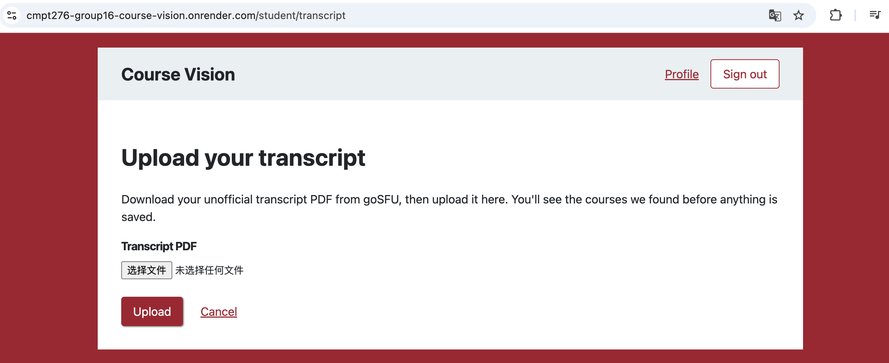

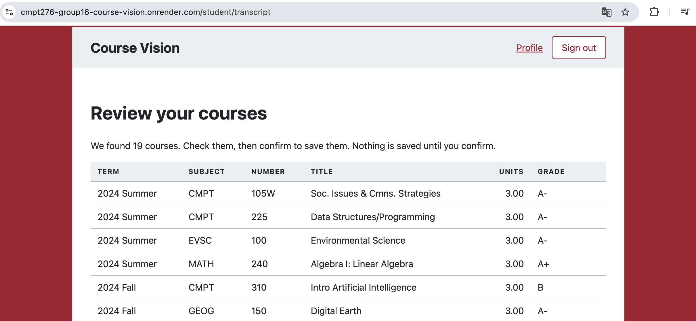

**Story 8. Confirm and Save Parsed Courses**

**User story.** As a student, I want to confirm the courses found in my transcript, so that they are saved to my record.

**Description.** The review page has a Confirm and save button and a Cancel button. Confirming saves the listed courses to the signed-in student's own record and returns the student to the home page with a message saying how many courses were saved. Cancelling throws the parsed courses away and saves nothing. If the student has already saved courses, the review page warns that confirming will replace them. Confirming then replaces the old courses in a single transaction, so uploading the same transcript again never creates duplicates, and a failed save leaves the old courses in place.

**Acceptance criteria.**

- Clicking Confirm and save adds the listed courses to the signed-in student's own record.
- Cancel discards them and saves nothing.
- Uploading the same transcript again does not create duplicate courses.

**Test cases.**

| ID | Type | Steps | Expected result |
| --- | --- | --- | --- |
| TC 8.1 | Success | After uploading a transcript, click Confirm and save on the review page. | The student returns to the home page, which shows "Saved 19 courses from your transcript." (or the matching number) and lists the courses. |
| TC 8.2 | Success | After uploading a transcript, click Cancel on the review page. | The home page shows "Nothing was saved from your transcript." and no courses are added. |
| TC 8.3 | Success | After TC 8.1, upload the same transcript again. | The review page warns that the saved courses will be replaced. |
| TC 8.4 | Success | After TC 8.3, click Confirm and save. | The old courses are replaced and the record contains no duplicate courses. |
| TC 8.5 | Failure | Log in as madden@test.com and confirm a transcript, then log in as jack@test.com. | Jack's record does not contain Madden's courses. |
| TC 8.6 | Failure | Click Cancel, then press Back and click Confirm and save. | Nothing is saved, because the parsed courses were already discarded. |

**UI.** The screenshot shows the bottom of the review page. Below the list of parsed courses, the student can click Confirm and save, click Cancel, or follow Upload a different file to choose another PDF.

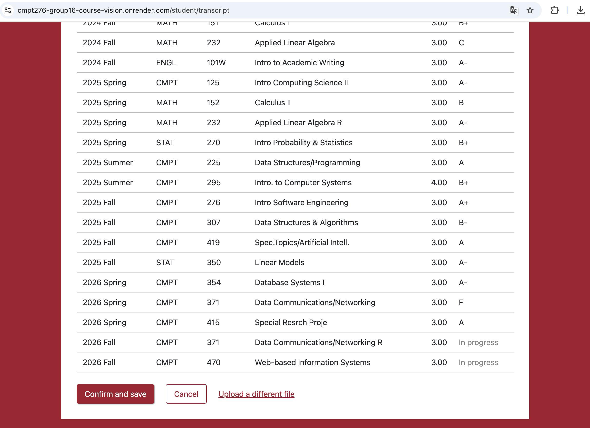

**Story 9. View My Course Record**

**User story.** As a student, I want to view the courses saved to my record, so that I can check them before using eligibility and the graduation report.

**Description.** The student home page links to a My courses page. This page groups the student's saved courses by term and shows each course's units and grade. A course that is still in progress has no grade yet, so its grade column says "In progress". A student with no saved courses sees a link to the upload page instead. Each student can only see their own record.

**Acceptance criteria.**

- The student home page links to a My courses page.
- Courses are grouped by term with units and grade, and courses in progress show "In progress" instead of a grade.
- A student with no saved courses sees a link to the upload page.
- Students can only see their own record.

**Test cases.**

| ID | Type | Steps | Expected result |
| --- | --- | --- | --- |
| TC 9.1 | Success | Log in as a student who has saved courses and open My courses from the home page. | The courses are grouped by term, with units and the grade for each course. |
| TC 9.2 | Success | Save a transcript that includes a course in progress, then open My courses. | The in-progress course shows "In progress" in the grade column. |
| TC 9.3 | Success | Log in as a student with no saved courses and open My courses. | The page shows a link to upload a transcript. |
| TC 9.4 | Failure | Log in as jack@test.com after Madden has saved courses. | Jack's My courses page shows only his own courses. |
| TC 9.5 | Failure | While signed out, open the My courses page. | The visitor is redirected to the login page. |

**UI.** The screenshot shows the My courses page. The saved courses are grouped by term, and the courses from the current term are marked "In progress" in the grade column.

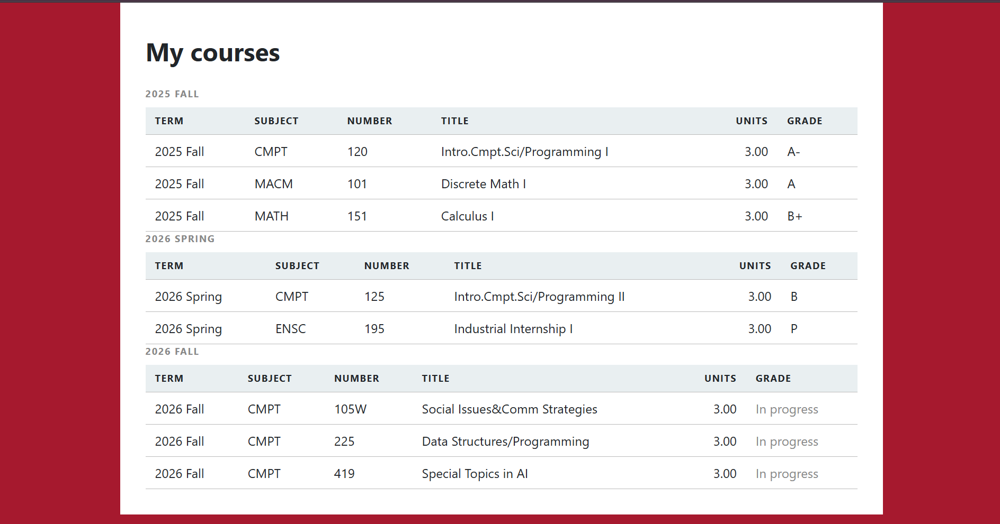

#### 2.4.6 Profile

**Story 10. Edit My Profile**

**User story.** As a student, advisor or IT manager, I want to view and edit my profile, so that my name, password and program stay correct.

**Description.** Every signed-in page has a Profile link in the header. The profile page shows the user's email and role, which cannot be changed, and their display name. Students also see their program and entry year. Users can change their display name, and students can change their program and entry year to the supported options. The server checks every field, and if anything is invalid, nothing is saved. After saving, the new name appears on the home page right away. Users can also change their password in a collapsible Change password section by entering their current password and the new one twice. The new password must follow the same rules as registration, and it is stored as a BCrypt hash. The server only reads the fields it expects, so the email and role cannot be changed even by editing the submitted form. The profile page is open to all three roles, but only for the signed-in user's own account.

**Acceptance criteria.**

- The Profile link opens a page showing the user's name, email and role, plus program and entry year for students.
- The display name can be changed, and the new name shows on the home page right away.
- The password can be changed by entering the current password and the new one twice. It is stored as a BCrypt hash.
- A wrong current password or mismatched new passwords show an error and change nothing.
- Students can change their program and entry year.
- Email and role cannot be changed, even by editing the form.
- Users can only see their own profile, and signed-out visitors are sent to the login page.

**Test cases.**

| ID | Type | Steps | Expected result |
| --- | --- | --- | --- |
| TC 10.1 | Success | Register a new student, then click Profile. | The page shows the email, role "Student", display name, program and entry year. |
| TC 10.2 | Success | Change the display name and click Save. | The page shows "Your profile was saved." and the home page greets the student by the new name. |
| TC 10.3 | Success | Change the program to Computer Engineering and the entry year to 2023, then click Save. | After a refresh, the new program and entry year are still selected. |
| TC 10.4 | Success | Open Change password, enter the current password and a new password twice, then click Change password. | The page shows "Your password was changed." After signing out, the new password works and the old one does not. |
| TC 10.5 | Failure | Replace the display name with only spaces and click Save. | The page shows "Display Name is required." and the name is unchanged. |
| TC 10.6 | Failure | Change the password with a wrong current password. | The Change password section opens with "Current password is incorrect." and the old password still works. |
| TC 10.7 | Failure | Enter two different new passwords. | The page shows "New passwords do not match." |
| TC 10.8 | Failure | Enter a new password with fewer than 8 characters. | The browser asks for at least 8 characters. If this is bypassed, the page shows "Password must be at least 8 characters." |
| TC 10.9 | Failure | Log in as advisor@example.com and open Profile. | No program or entry year fields appear, and the email and role are shown as plain text that cannot be edited. |
| TC 10.10 | Failure | While signed out, open /profile. | The visitor is redirected to the login page. |

**UI.** The first screenshot shows the profile page for the demo student Madden. The email and role are shown as plain text, while the display name, program and entry year can be edited. The second screenshot shows the Change password section after it is opened, with fields for the current password and the new password entered twice.

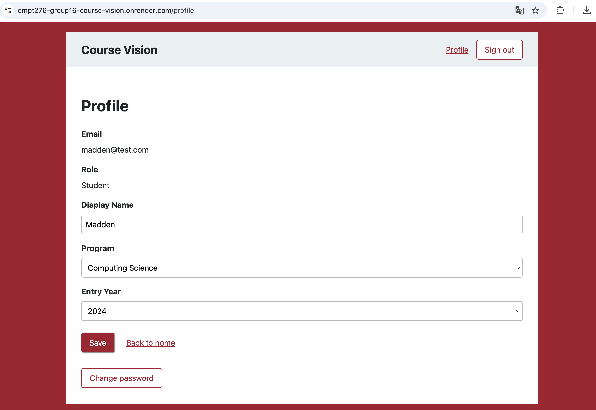

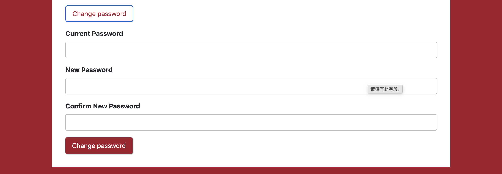

#### 2.4.7 Supporting Stories

**Story 11. Staff Accounts Created by the System**

**User story.** As an advisor or IT manager, I want to log in with an account created for me, so that nobody can give themselves a staff role by registering.

**Description.** Because the sign-up form only creates student accounts, advisor and IT manager accounts are set up by the system. When the application starts, it adds a demo advisor, a demo IT manager and two demo students if they are missing, and it assigns the advisor to both students. Running the startup again does not create duplicate accounts. The demo passwords come from an environment variable rather than from the source code. This story also defines the data model that the rest of the application uses. The users table stores a unique email, a password hash, a display name and a role. The student profiles table stores each student's program and entry year, and the advisor assignments table links an advisor to each student they support.

**Acceptance criteria.**

- The users table stores a unique email, a password hash, a display name and a role of Student, Advisor or IT Manager.
- Each student has one student profile with a program and an entry year.
- Advisor assignments link an advisor to each student they support.
- On startup, the app adds the demo advisor, demo IT manager and two demo students if they are missing, with the advisor assigned to both students.
- Demo passwords come from an environment variable, not the code.
- Tests cover duplicate emails and lookup by email.

**Test cases.**

| ID | Type | Steps | Expected result |
| --- | --- | --- | --- |
| TC 11.1 | Success | Log in as advisor@example.com and as Faye@example.com with password123. | Each account opens its staff home page. |
| TC 11.2 | Success | Restart the application, then log in as Faye@example.com and check the account count. | The demo accounts still exist and none of them are duplicated. |
| TC 11.3 | Failure | Register a new account through the sign-up form. | The new account always has the Student role. |
| TC 11.4 | Failure | Try to register with a demo staff email such as advisor@example.com. | The page shows "An account with this email already exists." |

**UI.** This story has no page of its own. Its results are visible on the advisor and IT manager home pages.

**Story 12. Public Deployment**

**User story.** As a user, I want to open Course Vision at a public web address, so that I can use it from any browser.

**Description.** The application is built from the project's Dockerfile and runs on Render. When the database variables are set, as they are on Render, it uses Render's PostgreSQL database. When they are not set, as on a developer's own computer, it uses an in-memory H2 database instead. This lets each team member run the application locally without extra setup, while the live site keeps its data between restarts.

**Acceptance criteria.**

- The app builds from the existing Dockerfile and runs on Render.
- It uses Render's PostgreSQL when the database variables are set, and H2 locally otherwise.
- Register, log in and log out work on the live site for all three roles.
- The live URL is in the README.

**Test cases.**

| ID | Type | Steps | Expected result |
| --- | --- | --- | --- |
| TC 12.1 | Success | Open the Render URL in a browser. | The login page loads over HTTPS. |
| TC 12.2 | Success | On the live site, register a student, then log in and log out as each of the three roles. | Every step works the same way as it does locally. |
| TC 12.3 | Success | Register a student on the live site, wait for the app to restart, then log in again. | The account still exists, because the data is stored in PostgreSQL. |

**UI.** Every screenshot in this section was taken on the live Render site, as shown in the address bar.

## 3. Implementation Summary

Course Vision is a Spring Boot web application that renders its pages on the server with Thymeleaf. This section shows how a request moves through the application and how the data is stored.

### 3.1 Request Flow

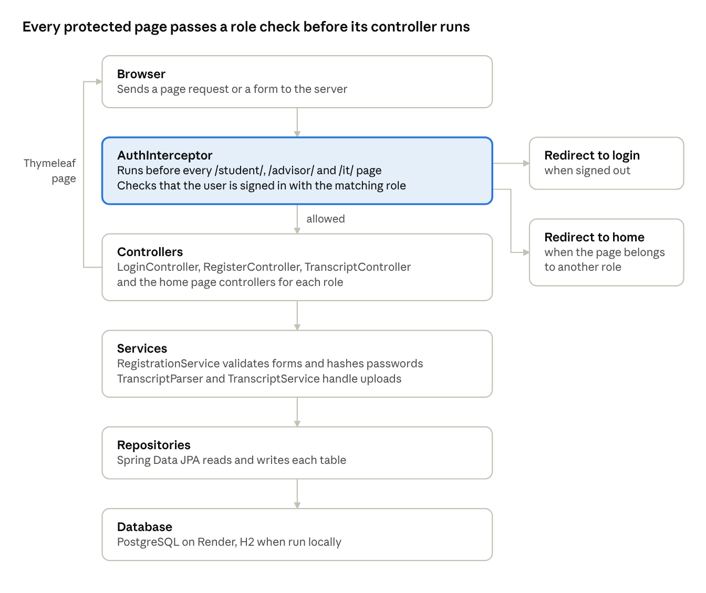

Every request for a student, advisor or IT manager page first passes through AuthInterceptor. A visitor who is not signed in is sent to the login page, and a user who opens another role's page is sent to their own home page. Only allowed requests reach a controller, which calls a service, reads or writes the database through a repository, and returns a page rendered with Thymeleaf. The login and sign-up pages skip this check, because visitors must be able to open them before signing in.

The transcript upload follows the same path. TranscriptParser reads the text of the uploaded PDF, and the parsed courses wait in the session until the student confirms. TranscriptService then replaces the student's saved courses in a single transaction, so a failed save leaves the old courses in place.

### 3.2 Database Design

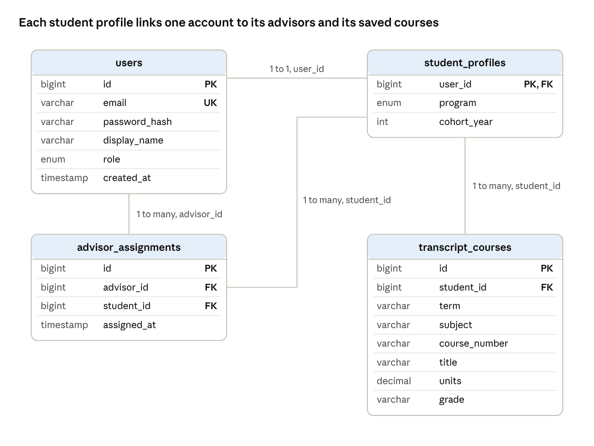

The database has four tables. The student profile is the centre of the design, because both advisor assignments and saved courses belong to a student.

- **users** stores every account. The email is unique and is saved in lowercase, so login is not case-sensitive. The password is stored only as a BCrypt hash, and the role is Student, Advisor or IT Manager.
- **student\_profiles** stores the program and entry year of each student. Its primary key is the same as the student's user id, so every student account has exactly one profile.
- **advisor\_assignments** links an advisor account to each student profile they support. Each advisor and student pair can appear only once.
- **transcript\_courses** stores one row for each course saved from a student's transcript. The grade is empty for a course that is still in progress, and confirming a new transcript replaces all of the student's rows.

## 4. Team Process and Workflow

### 4.1 Communication

The team communicates through a private Group 16 channel on the course Discord server and keeps shared documents in a Google Drive folder. We meet every Wednesday at 8:00 PM and hold extra meetings on weekends when needed. Members take turns recording the notes for each meeting, and the notes are included in Section 5.

Day-to-day work is tracked on a GitHub Projects board called Course Vision (Group 16). Each user story is a GitHub issue with the Story label, a checklist of acceptance criteria and a parent issue for its epic, such as Permission System & Database Management. Cards move through the Todo, In Progress, In Review and Done columns, and the board moves a card automatically when its pull request is opened or merged. This lets every member see who is working on what without asking in Discord.

Pull requests are the second place where the team communicates. Comments on a pull request are used to warn other members about changes that affect their work. For example, while reviewing PR #22, Madden pointed out that the temporary login page in that PR would clash with the real login in Feifei's branch, and explained which session key both branches needed to share.

### 4.2 Work Distribution

Each user story in Section 2 was tracked as a GitHub issue and assigned to one member. The table below links every story to its issue, its pull request and the member responsible for it.

| Story | Issue | Pull request | Assignee |
| --- | --- | --- | --- |
| Story 1. Student Registration | #7 | #29 | Feifei Yu |
| Story 2. Log In | #8 | #25 | Feifei Yu |
| Story 3. Log Out | #8 | #25 | Feifei Yu |
| Story 4. Role-Based Home Pages and Access | #9 | #34 | Abhishek Kapil |
| Story 5. Advisor Views Assigned Students | #32 | #34 | Abhishek Kapil |
| Story 6. IT Manager Views All Accounts | #33 | #34 | Abhishek Kapil |
| Story 7. Upload an Unofficial Transcript | #17 | #22 | Jack Hinderager |
| Story 8. Confirm and Save Parsed Courses | #18 | #26 | Jack Hinderager |
| Story 9. View My Course Record | #19 | #31 | Hikmat Kaur |
| Story 10. Edit My Profile | #23 | #35 | Madden Wynans |
| Story 11. Staff Accounts Created by the System | #11 | #21 | Madden Wynans |
| Story 12. Public Deployment | #10 | Deployed directly | Feifei Yu |

The team did not use pair programming in this iteration. Because the timeline was tight, each member worked on their own stories, and members coordinated through pull request reviews instead.

### 4.3 Git Workflow and Code Review

The main branch always holds working code, and nobody commits to it directly. Each story is built on its own branch named after the feature, such as feature/registration or feature/upload-transcript. When the work is ready, the author opens a pull request into main. When one story depends on another that is not merged yet, the author opens the second pull request against the first branch instead. PR #26 was built on feature/upload-transcript, and PR #29 was stacked on feature/login-logout. GitHub moved each one to main automatically once the branch below it was merged.

Every pull request description follows a similar structure. It names the issue it closes, summarizes the changes, lists the acceptance criteria it covers and reports the test results. For example, PR #21 listed each new test with what it checks, and reported 33 tests passing with no failures. Several descriptions also include notes for reviewers, such as known limitations or files that other branches will need to change.

The team has no fixed review rule. Instead, the author requests a review from the members whose work is most related to the change, and most pull requests had two reviewers. A reviewer either approves the pull request or requests changes, and the author answers each comment with a new commit before asking for another review. The pull request is merged once the reviewers approve. Merge conflicts are resolved by merging main into the feature branch and testing again before the final merge.

## 5. Meeting Notes

The regular meeting on October 21 was cancelled because members had a CMPT 276 midterm the next day, so the team held a make-up meeting on October 26 instead. All five members attended. Madden presented the first draft of the database schema, and Feifei shared a weekly status table in which each member reports the work they have done and how busy they expect to be until the next meeting. Then, the team discussed the scope of Iteration 1. Madden and Abhishek agreed to research the database schema and improve the draft, while Feifei took on looking into how to implement the login feature.

All members also attended the meeting on October 29. Madden showed the GitHub Projects board he had created, along with rough drafts of the stories as issues, and the team used it to distribute story points across the Iteration 1 stories. The team then discussed how advisors and IT managers should log in. An SFU ID login was considered, but it would need permission from SFU, so the team chose to build its own login. The team also agreed that IT manager permissions must be checked on the backend.

During the same meeting, the team assigned the story tickets. Madden took the user model and demo accounts, Feifei took login and logout, Jack took transcript upload, Abhishek took role-based home pages and access, and Hikmat took the course record view. The team then discussed the database setup and how to read and parse JSON data, and confirmed a tech stack of a Spring Boot (Java) backend with a PostgreSQL database. After talking through the overall architecture and workflow, the team discussed test-driven development and agreed to aim for three to five tests for each interface and module.

Jack, Feifei and Abhishek met on November 1 to check the Iteration 1 submission requirements and plan the remaining work. Feifei agreed to write the outline and first draft of the report, and Abhishek agreed to write the project requirements part. The team set 7:00 PM on November 2 as the deadline for the last merge into main, followed by a final check meeting around 9:00 PM. After the last merge, one member will record the screencast of the workflow and hidden features.

## 6. Iteration 1 Retrospective

### 6.1 What Went Well

Code review worked well in this iteration. Reviewers checked pull requests against the acceptance criteria of the related issue, as Abhishek did on PR #25, and they found real problems before the code reached main. On PR #29, for example, Jack found that a signed-in advisor could submit the registration form and lose their session, and that one test could never fail. Pull request descriptions were also detailed. Each one named the issue it closed, listed its changes and the acceptance criteria it covered, and reported the test results, which made reviews faster and easier to follow.

The GitHub Projects board and the story issues kept the work organized. Because Madden had created the board and rough drafts of the stories before the October 29 meeting, the team could assign the tickets directly during that meeting, and every member could see who was working on what. Members also helped each other across stories. When the login branch had conflicts with main, Jack pushed the follow-up commits directly to Feifei's branch so that PR #25 could be merged.

### 6.2 Challenges

The biggest challenge was time. The October 21 meeting was cancelled because of a midterm, so the stories were not assigned until October 29, and most pull requests were merged in the last few days of the iteration. Because of the tight timeline, the team also did not use pair programming, and each member worked on their own stories.

Working in parallel on shared code led to conflicts and duplicated work. PR #27 and PR #25 made the same redirect change in two different ways, and the team had to decide which version to keep. The temporary login page in PR #22 clashed with the real login page, and the two branches stored the signed-in user under different session keys, so both had to be fixed during the merge. In addition, PR #24 was merged into feature/upload-transcript instead of main by mistake, and its changes had to be submitted again in PR #26.

### 6.3 Improvements for Iteration 2

In Iteration 2, the team will assign stories at the start of the iteration and set the deadline for the last merge early, so that merges are spread out instead of crowded into the final two days. Before starting work, members will agree on the parts that several stories share, such as session keys, template folders and the common header, so that each branch builds on the same choices.

Members will also check the project board before starting a change, to see whether someone else is already working on the same code, and confirm the base branch before opening a pull request. Finally, the team will consider a simple review rule, such as requiring at least one approval before any pull request is merged into main.

## 7. Plans for Iteration 2

Iteration 2 will build on the academic record from Iteration 1 and start the first planning features. The team plans to finish three pieces of work.

The first is the Correction panel, which was moved from Iteration 1. After uploading a transcript, students will be able to add, edit or remove courses by hand. This lets them fix courses that the parser reads incorrectly and add transfer credits, which do not appear on SFU transcripts.

The second is importing course data from the SFU Course Outlines API. Course information for CMPT and ENSC courses, along with the MATH and MACM courses that appear in their prerequisites, will be stored in the application's database. The Course Eligibility Engine will then read course data from the database instead of calling the API directly.

The third is a first version of the Course Eligibility Engine. Using the courses in a student's record, the engine will determine which courses the student can take next semester. When a student is not eligible for a course, it will explain which prerequisite is missing instead of only marking the course as unavailable.
